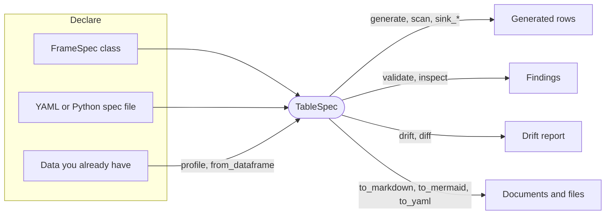

# How the pieces fit

polspec has one idea: a spec says what a table holds, and every verb reads
it. This page says what each piece is, which verbs read it, and why a few
things that look alike are kept apart.



## The pieces

- **`ColSpec`** declares one column: its dtype, nulls, bounds, choices,
  format and the rest. On its own it is a value, and says nothing about
  other columns.
- **`TableSpec`** is a whole table as an immutable value: its columns in
  order, and what holds between them — checks, keys, a hierarchy, an
  order. Two specs that say the same thing are equal, and a spec pickles,
  copies and hashes like any value.
- **`FrameSpec`** is a way to write a `TableSpec` as a class body. The
  class builds `Orders.spec`, a `TableSpec`, and its classmethods forward
  to the functions with it. Subclassing reuses columns, as inheritance
  does anywhere.
- **`Registry`** holds several specs and the foreign keys between them, so
  parents are generated before children and validated against them.
- **`CatSpec`** names categories several specs share, so an `Enum` or a
  `Categorical` means the same thing in each.

A spec comes from any of three places — a class body, a spec file, or data
profiled into one — and is the same value whichever it came from.

## Verbs are functions; a spec is a value

Every verb is a function over a `TableSpec`: `polspec.generate(spec, n)`,
`polspec.validate(spec, df)`, `polspec.drift(spec, df)`. A `FrameSpec`
class has each as a classmethod too, which reads better when a class body
declared the spec.

A `TableSpec` has none of them. The declarations — `ColSpec`,
`TableSpec`, checks, keys — import nothing of generation or validation, so
a spec stays data that every verb reads and none owns; an import contract
holds the line. Asked for a verb, a spec says which function to call:

<!-- docs: raises -->
```python
import polars as pl
import polspec

df = pl.DataFrame({"id": [1, 2, 3]})
spec = polspec.profile(df)
spec.validate(df)
# AttributeError: TableSpec has no method 'validate': a spec is a value, and
# every verb is a function over it. Call polspec.validate(spec, ...), or
# FrameSpec.from_spec(spec) for a class with the methods.
```

`FrameSpec.from_spec(spec)` wraps a value in a class when the methods are
wanted. See [Specs as values](../how-to/tablespec.md).

## What generation keeps, and what only validation checks

Generation and validation read the same claims, and generation keeps
almost all of them: a generated frame validates against its own spec.

- **Kept by construction:** dtypes, nulls, bounds, choices and weights,
  formats and patterns, `unique`, composite keys, rules, derived columns,
  hierarchies, row order — and foreign keys, given the parent's data.
- **Kept when asked:** `__checks__` and column validators are arbitrary
  expressions, which nothing can draw values to satisfy. `checks=True`
  keeps the rows that pass them and reads on for more; without it, they
  are left to validation. See
  [Keeping checks](../how-to/generating.md#keeping-checks-checkstrue).
- **Only validated:** `__rows__`, since `generate()` makes the rows asked
  for.

The full table is in [Constraints](../how-to/constraints.md).

## Describe, or imitate

Data becomes a spec in one of two ways, which record different things by
default because they are for different readers:

| | Describe | Imitate |
|:--|:--|:--|
| Python | `FrameSpec.from_dataframe(df)` | `polspec.profile(source)` |
| Command line | `polspec schema infer` | `polspec synthesize --spec` |
| For | a contract a person reads and edits | a stand-in: fake data that looks like this data |
| Records | what each column is | that, plus category frequencies, fitted distributions, keys and row order |
| Bounds and rates | `schema infer` rounds them outward, to two significant figures | exact, as observed |

So `schema infer` on ids from 1 to 150 writes bounds `[0, 150]`: rounded
outward, so the data stays inside and the number reads as a person would
write it. `--round-bounds exact` keeps `[1, 150]`. Either way can record
anything the other does; only the defaults differ. See
[Infer a spec from data](../how-to/profiling.md).

## Seeds

Generated data is seeded by name, not by position: each column draws from
the frame's seed and its own name, and each pass — a rule, a key — from the
seed and what it is for. So adding, removing or reordering a column leaves
every other column's values as they were, a projected `scan` holds what the
whole frame holds, and a batch is a window onto the frame `generate` would
make. Within a major version the same call gives the same frame on every
platform; [Stability](stability.md#seeded-output) says what that promises.
